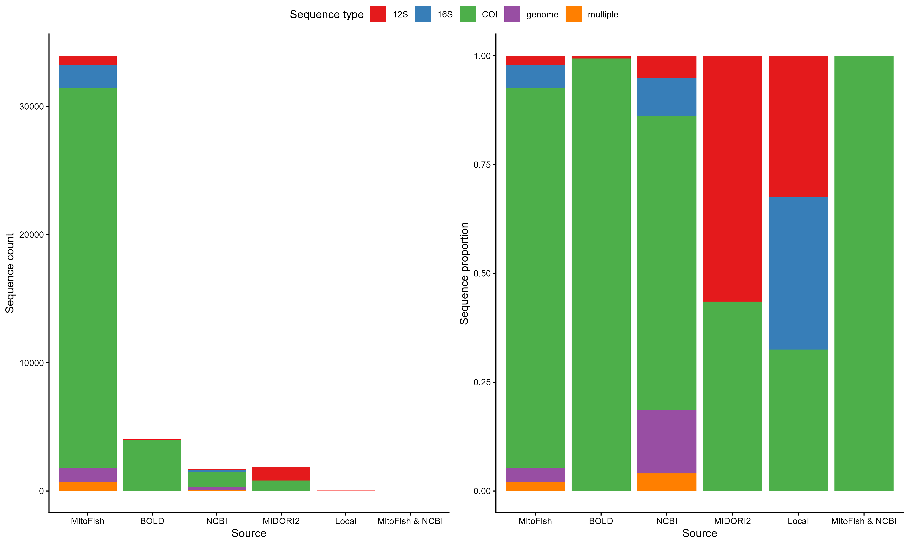

```{r include=FALSE}
knitr::opts_chunk$set(echo = TRUE, eval = FALSE, collapse = TRUE, comment = "#>", fig.path = "casestudy-")
library(regionbarcoder)
library(tidyverse)
output_path <- system.file("extdata", "case_study_outputs.rds", package = "regionbarcoder")
output <- readRDS(output_path)
```

# Introduction

This vignette demonstrates the complete workflow of the `regionbarcoder` package using a real-world environmental DNA (eDNA) dataset from the Yangtze River basin. We will walk through installing the `YZFishDB` reference database, auditing its taxonomic and marker coverage, assessing its barcoding gap diagnostic, benchmarking assignment methods (Exact vs. BLASTn), resolving taxonomic ties, and generating a final species-by-site ecological matrix.

## How to read this vignette

This vignette produces three types of outputt:
 
 1. **Database inventory** - table names, row counts, and file paths.
 
 2. **Audit summaries** — QC flags, taxonomic counts, marker coverage, source composition, and barcode-gap statistics returned as data frames.
 
 3. **Exported reference files** — FASTA and taxonomy tables written to disk for use in DADA2, QIIME2, BLASTn, or USEARCH/VSEARCH.

Guiding questions:

Audit summaries: *Does this database contain enough relevant reference material for my intended marker and taxonomic group?*

Exported files: *Does the exported file correspond exactly to the filtered reference set inspected?*

> Note: This vignette uses a pre-compiled output object (`case_study_output.rds`) so that it can render without requiring local `YZFishDB.db` reference database installation. To run this code locally, ensure you update the file paths in the setup chunk to match your system. 

# 1. Database Setup and Configuration

## Installing the Reference Database

This case study uses `YZFishDB`, a curated mitochondrial DNA reference database (~600MB) hosted on Zenodo and can be downloaded and cached locally using the built-in installation function:

```{r}
library(regionbarcoder)

# Download and verify the YZFishDB release from Zenodo
rb_install_db()

# Inspect the release metadata
rb_yzfishdb_release()
```

Once installed, connecting to the database is seamless:

```{r}
con <- rb_connect()
rb_tables(con) # Inspect available tables in the database
```

`rb_connect()` opens a SQLite connection without loading the entire database into R memory. The returned `con` object is passed to all downstream functions.

`rb_tables()` inventories the relational tables stored inside the connected database. The main reference table contains one row per sequence; optional diagnostic tables (e.g., `barcode_gap_metrics`, `ambiguous_sequences`) may or may not be present depending on the database release. Missing diagnostic table is not an error but simply means that layer of audit was not included in the connected database.

## Loading libraries

For this case study, we also load `tidyverse` for data manipulation and `Biostrings` for FASTA handling.

```{r message=FALSE, warning=FALSE}
library(regionbarcoder)
library(tidyverse)
library(Biostrings)
```

# 2. Auditing the Reference Database

Before assigning sequences, it is crucial to understand the composition of the reference database. `regionbarcoder` provides built-in functions to audit taxonomic and marker coverage dynamically.

## Taxonomic and Source Coverage

### Audit QC Flags

```{r}
qc_summary <- rb_qc_summary(con)
print(qc_summary)
```

```{r eval=TRUE, echo=FALSE}
print(output$qc_summary)
```

`qc_summary` reports how many sequences (`n_sequences`) carry each type of quality-control flags (`qc_flag`). In a curated release like `YZFishDB`, mostt sequences are flagged `pass`, meaning they passed the curation filters. Non-`pass` flags (e.g, `divergent`, `sequence_short`) record sequences that were retained for provenance but excluded from default reference database selection.

### Audit taxonomic coverage by marker

```{r eval=FALSE}
species_12s <- rb_list_taxa(con, rank = "species", marker = "12S")
species_all <- rb_list_taxa(con, rank = "species")

head(output$species_12s)
head(output$species_all)

cat("Species with 12S data:", nrow(species_12s), "\n")
cat("Species with any marker data:", nrow(species_all), "\n")
```

```{r eval=TRUE, echo=FALSE}
head(output$species_12s)
head(output$species_all)

cat("Species with 12S data:", nrow(output$species_12s), "\n")
cat("Species with any marker data:", nrow(output$species_all), "\n")
```

`rb_marker_coverage()` shows how many sequences (`n_sequences`) and how many distinct taxa (`species`) are represented for each (or the selected) marker (`seq_type`). A marker with broad species coverage is typically preferable for regional surveys, though this decision should be informed based on the geographic region and target taxa as markers common markers may not always yield the best results. 

Regardless, sparse marker coverage (e.g., 16S for 241 species vs. 12S for 429 species) can help us decide whether ASVs should be derived from particular primers and warns us that ASVs derived from under-represented taxa will likely be unassigned or ambiguous.

### Audit source coverage

```{r}
source_cov <- rb_source_coverage(con)
print(head(source_cov))
```

```{r eval=TRUE, echo=FALSE}
head(output$source_cov)
```

We can visualize the provenance of the reference sequences to understand the composition of the database across different markers.

```{r}
source_cov_plot_data <- source_cov |>
  mutate(Source = factor(
    source,
    levels = c("mitofish", "bold", "ncbi", "midori", "local", "mitofish|ncbi"),
    labels = c("MitoFish", "BOLD", "NCBI", "MIDORI2", "Local", "MitoFish & NCBI")
  ))

p1 <- ggplot(source_cov_plot_data,
             aes(x = Source, y = n_sequences, fill = seq_type)) +
  geom_bar(stat = "identity") +
  scale_fill_brewer(palette = "Set1", name = "Marker") +
  labs(y = "Sequence Count", title = "Absolute Sequence Counts by Source") +
  theme_classic() +
  theme(axis.text.x = element_text(angle = 45, hjust = 1))

p2 <- ggplot(source_cov_plot_data,
             aes(x = Source, y = n_sequences, fill = seq_type)) +
  geom_bar(stat = "identity", position = "fill") +
  scale_fill_brewer(palette = "Set1", name = "Marker") +
  labs(y = "Proportion", title = "Proportion of Markers by Source") +
  theme_classic() +
  theme(axis.text.x = element_text(angle = 45, hjust = 1))

ggpubr::ggarrange(p1, p2, common.legend = TRUE, ncol = 2)
```

```{r eval=TRUE, echo=FALSE, out.width="80%", fig.cap="Left: Absolute sequence counts by source. Right: Proportional contribution of sequence types for each source."}

```

Source composition tells us **where** the reference material was sourced from, which can affect the confidence in taxonomic annotations. Databases dominated by a single major source, may reflect the specificity of the database or the potential bias of its references. Conversely, local collections often used to fill region-specific gaps may introduce curator-dependent annotation risks.

## Barcode Gap Diagnostic

A critical step in metabarcoding is validating the marker's ability to distinguish species. The "barcode gap" represents the difference between maximum intraspecific (within species) and mininum interspecific (between species) genetic distances.

Currently the barcode gap metrics are imported as a separate CSV. Here we assess the median barcode gap by the number of species with "12S" sequences in the `YZFishDB` reference database.

```{r eval=TRUE}
gap_metrics <- rb_read_barcode_gap(marker = '12S')

gap_summary <- gap_metrics |>
  mutate(gap_median = median_inter > median_intra) |>
  group_by(gap_median) |>
  summarise(n_species = n_distinct(species))

gap_summary
```

Barcode-gap diagnostics estimates whether intraspecific variation is sufficiently separated from interspecific divergence for a given marker and taxon. A positive median gap suggests that the marker can resolve species boundaries for that group. A zero or negative gap warns that congeneric species may share identical or near-identical sequences increasing the likelihood of assignment ties.

In this example, 93 of 113 taxa (`r round(93/113*100, 1)`%) tested from `YZFishDB` has a median barcode gap, while the remaining taxa are potentially ambiguity hotspots for metabarcoding.

# 3. Exporting Pipeline-Ready References

Beyond taxonomic assignment, `regionbarcode` can format the user-defined selection of the reference database for use in other popular bioinformatics pipelines.

```{r}
native_12s <- rb_get_sequences(con, marker = "12S", occurrence = "native")

rb_export_dada2(native_12s, "refs_dada2.fasta")
rb_export_qiime2(native_12s, "refs_qiime2.fasta", "refs_qiime2_tax.tsv")
rb_export_blastn(native_12s, "refs_blastn.fasta")
rb_export_usearch(native_12s, "refs_usearch.fasta")
```

These exports preserve a consistent seven-rank taxonomy string while adapting headers to DADA2, QIIME2, BLASTN, and USEARCH/VSEARCH conventions.

The export functions do not modify the SQLite database, but write flat files for downstream software. The number of exported sequences should match `nrow()` of the filtered reference object selected (`native_12s`).

# Conclusion

This case study demonstrates how `regionbarcoder` streamlines the eDNA taxonomic assignment workflow. By dynamically querying the `YZFishDB` database, utilizing robust alignment metrics (`ccovs`), and providing a standardized framework for tie curation (`check_full_tie`), the package ensures reproducible, transparent, and bioinformatically rigorous species assignments.

```{r}
rb_disconnect(con)
```
